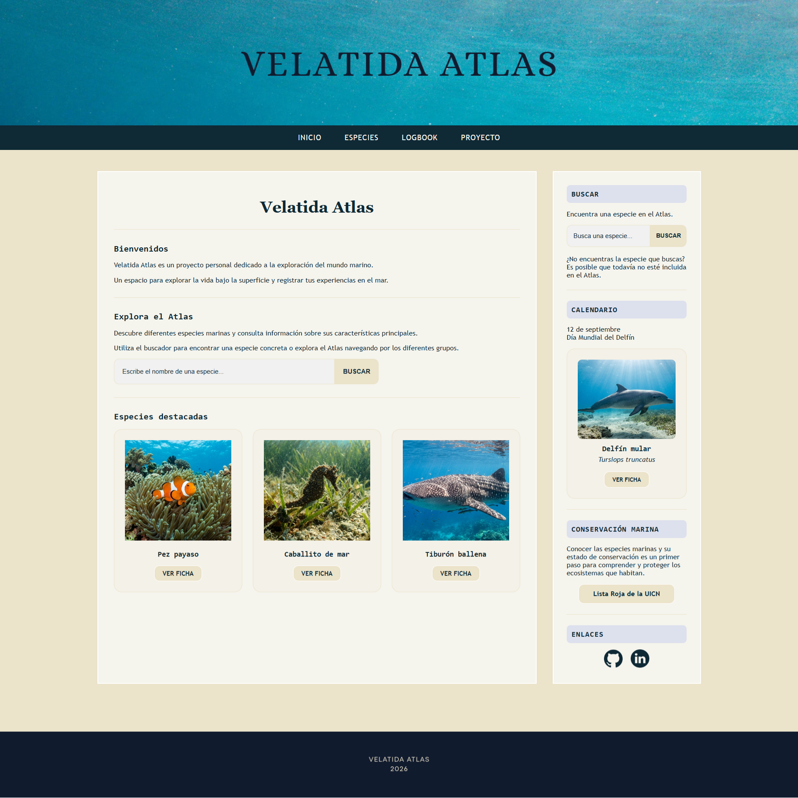
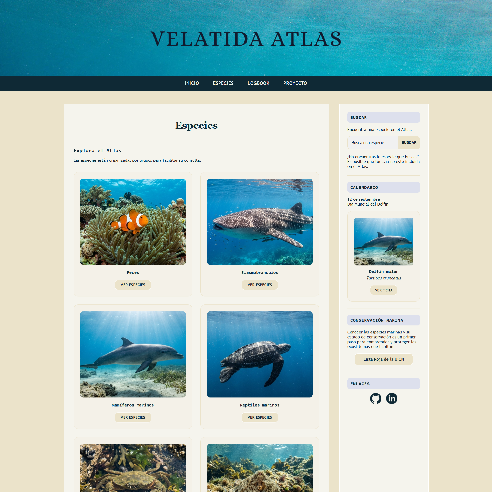
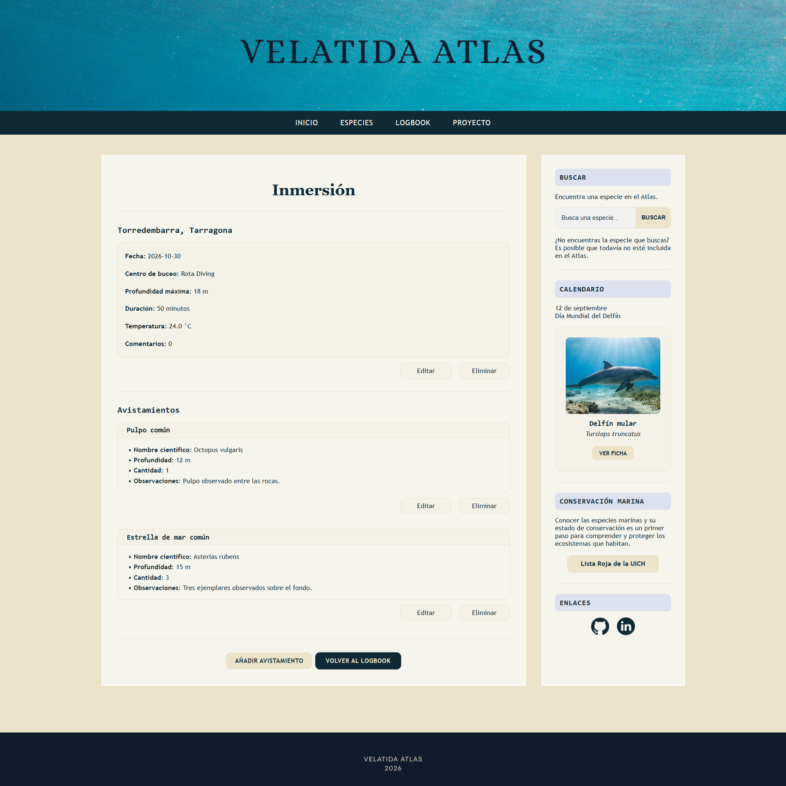

# Velatida Atlas

Proyecto personal de portfolio sobre una base de datos relacional de especies marinas.

-----------

🌐 Web publicada: Velatida Atlas https://velatida-atlas.rf.gd/

💻 Repositorio: Código fuente y documentación del proyecto.

-----------

# Capturas del proyecto

  
  
  

-----------

# Base de datos

La base de datos almacena y relaciona información sobre especies marinas, usuarios, inmersiones y avistamientos.

Las especies incluyen información sobre sus características, hábitat, distribución, profundidad y estado de conservación.

El logbook permite registrar inmersiones y las especies observadas durante ellas.

-----------

# Contenido del proyecto

- Atlas de especies marinas
- Consulta y búsqueda de especies
- Fichas individuales de especies
- Registro de usuarios
- Logbook de inmersiones
- Registro de avistamientos
- Gestión de inmersiones y avistamientos (CRUD)

-----------

# Carpetas de recursos

- Database
- Diagramas
- Web
    - Logbook
    - Includes
    - Images
    - CSS

-----------

# Imágenes

Las imágenes utilizadas en las fichas de especies han sido generadas mediante inteligencia artificial. 

Se ha optado por esta alternativa para evitar utilizar fotografías de terceros sin conocer con certeza sus condiciones de licencia y para mantener una estética visual coherente en el proyecto.

-----------

# Tecnologías utilizadas

- SQL
- MariaDB
- PHP
- HTML
- CSS
- HeidiSQL
- Git
- GitHub

-----------

Estado: En desarrollo 🚧

-----------

# Autor

Velatida 

Proyecto personal desarrollado con fines de aprendizaje y portfolio.

-----------